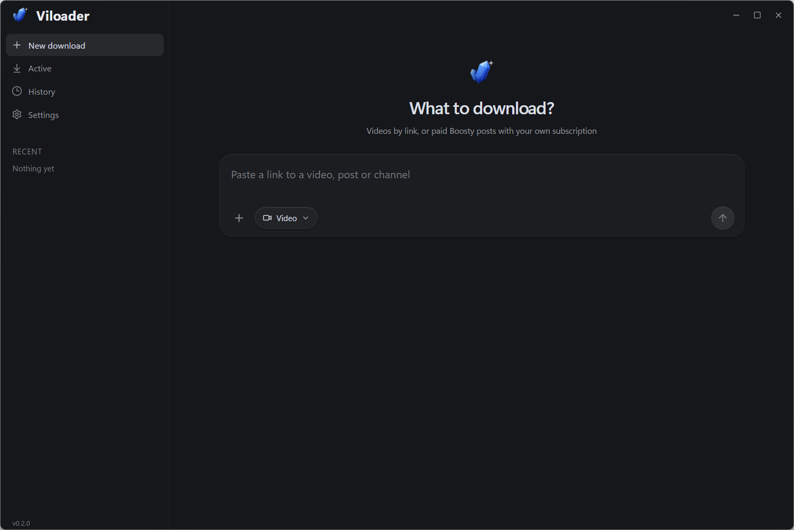
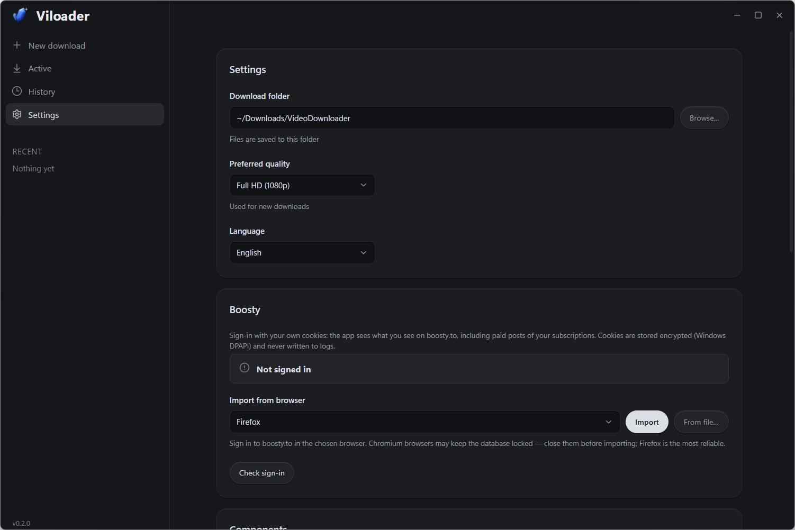

<div align="center">


# Viloader

**Downloads paid Boosty posts with your own subscription — a single post or an author's whole feed in one click. Plus 1000+ sites via yt-dlp.**

[](https://tauri.app/)
[](https://www.rust-lang.org/)
[](#-install)
[](LICENSE)

</div>

---

## ⭐ What other downloaders don't do

Popular yt-dlp front-ends (Parabolic, yt-dlp-gui, Stacher) can only do what yt-dlp does, and yt-dlp has no Boosty feed support: a channel link falls through to the generic extractor and grabs a random video from the page. Viloader makes Boosty a first-class source:

- **Sign in with your own cookies — one click from your browser.** Firefox, Chrome, Edge, Brave, Opera, Vivaldi, Yandex Browser: only `boosty.to` cookies are taken from the profile; other sessions are neither kept nor stored.
- **The whole feed your subscription unlocks.** “Whole accessible feed” walks every post of the author (up to 5000), keeps the ones your tier opens and downloads them one by one into `Boosty\<author>\<date> <post>`. Re-running fetches only what is new.
- **Posts with several videos and audio tracks** — pick files and quality (up to 4K); embedded YouTube/Vimeo videos are downloaded too.
- **Clear errors instead of “HTTP 401”.** The app tells apart “cookies expired”, “paid post and you are not signed in” and “signed in, but no subscription of this tier (price)”. An expired token is refreshed automatically and the new pair is saved, so yt-dlp gets it right away.
- **Cookies are never stored in plain text.** The store is encrypted with Windows DPAPI (only your Windows user on this PC can decrypt it); cookies are never logged or shown again. The plain copy for yt-dlp lives only while the process runs.
- **Flaky network, steady downloads.** Boosty API calls are retried with exponential backoff (1→2→4 s); yt-dlp runs with `--retries`/`--fragment-retries` and up to 30 s pauses.

## 📸 Screenshots





## ✨ Also

- 1000+ sites via [yt-dlp](https://github.com/yt-dlp/yt-dlp): YouTube, Vimeo, TikTok, VK, Rutube, Twitch…
- Quality choice and audio-only, progress with speed and ETA; cancel kills the whole process tree (job object).
- Download history with search and filters.
- **A single portable exe**, no installer, no admin rights. yt-dlp and FFmpeg are not bundled: on first run the app downloads them from GitHub into a `tools` folder next to itself and checks a pinned SHA-256.
- The window remembers size, position and maximized state; the close button hides it to the tray (Open / Quit menu, clicking the icon restores the window); a second launch raises the running window.
- Russian and English UI: the language follows Windows and can be switched in Settings.

## 📦 Install

1. Download `Viloader-<version>-portable.exe` from [Releases](https://github.com/AndreyFSDev/Viloader/releases).
2. Put it into any writable folder and run it. WebView2 Runtime is required (shipped with Windows 10/11).
3. Press “Download components” (≈135 MB, once).
4. For Boosty: sign in to boosty.to in your browser → Settings → Boosty → “Import”.

> Chrome 127+ encrypts cookies with App-Bound Encryption, which yt-dlp cannot read — the app says so. Firefox, or importing a Netscape `cookies.txt` or JSON tokens, is the most reliable path.

## 🛠 Build

```bash
npm install
npm run tauri dev      # development
npm run portable       # release/Viloader-<version>-portable.exe
```

Requirements: Node.js 20.19+ / 22.12+, stable Rust, WebView2. Release profile: `lto`, `opt-level = "s"`, `codegen-units = 1`, `strip`, `panic = "abort"`. In dev builds yt-dlp/FFmpeg can be placed in `src-tauri/binaries/` to avoid downloading them into `target`.

Tests: `npm test` (frontend utilities), `cargo test` in `src-tauri` (Rust; live Boosty API and component install tests are `#[ignore]`).

## 📜 License

Licensed under [Apache-2.0](LICENSE). [NOTICE](NOTICE) carries the copyright attribution that must travel with the program.

Third-party components that the app downloads itself and does not redistribute: yt-dlp (The Unlicense), FFmpeg essentials by Gyan Doshi (GPL v3).

